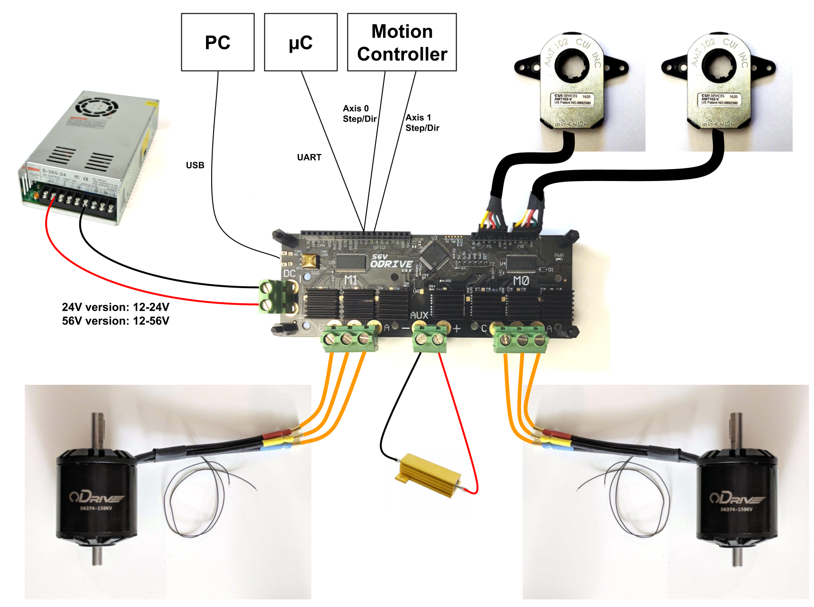

# ODrive Startup Guide
This tutorial steps you through the process of getting an brushless DC motup and running with the ODrive controller.

## Overview
This document guides you through what I did to get the ODrive controller working. I will show the process end to end, and provide a few more details than what the default ODrive documentation ["Getting Started"](https://docs.odriverobotics.com) page outlines. However, I won't repeat every single step shown in the ODrive documentation. I'll mainly focus on where my process deviated from the default one. I'll show you the proper connections, the sequence of functions and parameters to change, as well as common pitfalls. I'll then point you to how to configure the controller for various control modes. Lastly, I'll show you how to set up the controller for communication with a microcontroller (i.e. Teensy 3.6).

## Hardware
- [24V ODrive](https://odriverobotics.com/shop/odrive-v36)
- [Teensy 3.6 microcontroller](https://www.pjrc.com/store/teensy36.html)
- [36BLR65-24-01 STEPPERONLINE brushless DC motor](https://www.omc-stepperonline.com/brushless-dc-motor/24v-3000rpm-0064nm-20w-109a-round-%D1%8436x65mm-brushless-dc-motor-36blr65-24-01.html?limit=100)
	- 4 poles (2 pole pairs)
	- UVW hall efect sensors (not used)
	- Rated speed: 3000RPM
	- Stall torque: 0.220 N-m
	- Rated current: 1.09A
	- Stall current = 3.565A
- [AS5601 (AMS) Contactless hall effect sensor/encoder](https://ams.com/AS5601)
	- Outputs an absolute angle or an adjustable AB quadrature outputs up to 1024 CPR
	- Configured using I2C via a microcontroller (Teensy 3.6)
	- Does not have an index signal. For a similar encoder that outputs an index signal, check out the AS5047
- 30V/10A power supply
- 50W resistor (comes with ODrive)

## Wiring

- The default wiring is correct. However, if you want to communicate with an microcontroller via UART, connect pin 1 (RX) on the ODrive to the microcontroller's TX pin and pin 2 (TX) on the ODrive to the microcontroller's RX pin
	- On the Teensy 3.6, when using Serial1 (HardwareSerial) these pins are pins 1 (TX) and pin 0 (RX)
- In this example, I'm only using one motor (M0)
- If you are simultaneously using a microcontroller alongside the ODrive, make sure their ground pins are connected (either directly or via a breadboard)

## Startup and Calibration
Install Python/Anaconda Prompt odrivetool as outlined by the ODrive documentation and open Anaconda Prompt. Then launch odrivetool
```
odrivetool
```

Confirm you are properly communicating with the ODrive by reading the bus voltage. It should return a a value equal to (or close to) the power supply voltage.
```
odrv0.vbus_voltage
```

Unless you've changed the default startup procedure, the motor should be in the IDLE state. You can check the current state using `odrv0.axis0.current_state`. This should return 1 (AXIS_STATE_IDLE). If it doesn't, set your motor to the IDLE state
```
odrv0.axis0.requested_state = AXIS_STATE_IDLE 
``` 

Configure the current limit [A].I set my current limit to the stall current of the motor. However, it might make sense to lower the current to some fraction of that to better protect the motor or based on the maximum allowable torque for your system
``` 
odrv0.axis0.motor.config.current_lim = 3.5
```

Configure the velocity limit [turns/sec] based on the requirements of your system. At most, this should be the no load speed of your motor but should likely be limited further by the requirements of your system
``` 
odrv0.axis0.controller.config.vel_limit = 20
```

Configure the calibration current [A]. I set this to just under the reated current of the motor.
``` 
odrv0.axis0.motor.config.calibration_current = 0.75
```

Configure the resistance calibration max voltage [V]. The documentation suggests setting this to at most half of your power supply voltage. I'm not sure why. I was powering the motor with 12V so I was sure to leave this voltage below 6V.
``` 
odrv0.axis0.motor.config.resistance_calib_max_voltage = 4.0
```

Set the brake resistance [Ohms] if you're using a brake motor. I used the resistor that came with the ODrive. I measured the resistance using a multimeter so was able to input it directly.
``` 
odrv0.config.brake_resistance = 2.5
```

Set the number of pole pairs. This can be tricky since a lot of motor datasheets are unclear on whether they're listing the number of poles or the number of pole pairs. The ODrive documentation outlines a good method of figuring out the number of pole pairs.
``` 
odrv0.axis0.motor.config.pole_pairs = 2
```

Set the motor type. Based on what the documentation describes, my motor might be of the scale that qualifies it as a "gimbal motor". But I wasn't sure so I left it as *MOTOR_TYPE_HIGH_CURRENT*. This may have required me to adjust a few more parameters than I would've had to otherwise.
``` 
odrv0.axis0.motor.config.motor_type = MOTOR_TYPE_HIGH_CURRENT
```

Set the torque constant. Unless the motor's manufacturer provided this value on the datasheet, chances are you don't know it and will have the determine this value experimentally. I didn't have this value measured upon calibration so I think just getting this value in the ballpark should be good enough. You may even be able to leave this as the default value
``` 
odrv0.axis0.motor.config.torque_constant = 0.063
```

Set the encoder counts per revolution [CPR]. Via the microcontroller (using I2C), I configured the CPR to 1024. Note that for the AS5601, this value is reset every time you power down the sensor. So I had to redo this every time I unpowered my system. Other encoders either have a constant CPR or can be programmed to non-volatile memory (i.e. AS5047), which is great.
``` 
odrv0.axis0.encoder.config.cpr = 1024
```

You should be able to run the calibration sequence right now, but it might also be worth measuring the phase resistance and inductance of the motor manually. You can do this using an LCR meter or a multimeter (only resistance). Once you run the calibration sequence, the values you input will be overridden, but it's good to verify that the values after calibration are reasonably close to the real values. I've listed the values determined by the calibration sequence
``` 
odrv0.axis0.motor.config.phase_resistance = 1.95
odrv0.axis0.motor.config.phase_inductance = 0.003
```

Now, run the calibration sequence. This will do a few things. It will measure the motor's phase resistance and phase inductance. It will also determine the offset between the encoder and the phases so it can do proper commutation.
``` 
odrv0.axis0.requested_state = AXIS_STATE_FULL_CALIBRATION_SEQUENCE
```
- If this proceeds properly, you'll hear a beep for about a second. Then the motor will spin a few times in one direction then immediately spin a few times in the other direction. If the ODrive didn't complete this entire process, chances are something triggered an error. Before calibration can proceed, the error must be addressed and cleared.

### Errors and Potential Pitfalls
I'll now go through the errors I ran into when calibrating this motor. You may run into entirely different errors depending on what you did or the motor you're using. Unfortunately, the documentation doesn't do a great job of identifying the likely cause of these errors. This section won't be exhaustive so the [ODrive Community Forum](https://discourse.odriverobotics.com/) will be your best friend.

First you should know how to output errors to the console. I wish odrivetool automatically did this when errors were triggered, but oh well
``` 
dump_errors(odrv0)
```
When you've addressed an error, you'll want to clear it. You won't be able to calibrate or run the motor until you've done so
``` 
dump_errors(odrv0, True)
```

*ERROR_CPR_POLEPAIRS_MISMATCH*: This means your either your encoder CPR or pole pairs is different than what was configured via odrivetool. This will usually be triggered after the ODrive has completed the turns in one direction, before it turns in the other direction. In my case, I had forgotten the AS5601 encoder would revert to 8 CPR after a power down and that I needed to reconfigure it using the Teensy to 1024 CPR. Also, it is common to confuse CPR with PPR. CPR = PPR x 4. CPR is the number of rising and falling edges you'll see on pins A and B upon turning the motor once. You can confirm this using an oscilliscope, quadrature decoder (the Teensy has an *Encoder* library that should be useful for this), or a logic analyzer. If you've confirmed this, you should then make sure you input the correct number of pole pairs.

*ERROR_PHASE_INDUCTANCE_OUT_OF_RANGE*: This will usually be triggered after the ODrive beeps at the beginning of the calibration sequence. But it won't turn. This error was caused by a few issues. First, I needed to adjust *odrv0.axis0.motor.config.calibration_current* and *odrv0.axis0.motor.config.resistance_calib_max_voltage*. After this I was finally able to calibrate successfully. However, this error was still triggered randomly at the start of calibration. What I had to apply a little torque to the motor shaft with my fingertips during the beep. This wasn't a guaranteed fix, but it helped.

*ERROR_PHASE_RESISTANCE_OUT_OF_RANGE*: This was less common than *ERROR_PHASE_INDUCTANCE_OUT_OF_RANGE*, but I believe adjusting *odrv0.axis0.motor.config.calibration_current* and *odrv0.axis0.motor.config.resistance_calib_max_voltage* should help.

If you see the motor beep then complete turns in both directions, print errors to the console using `dump_errors(odr0)`. If you don't get any errors, the calibration procedure worked. You can now begin using the motor. I would now save the configuration so everything you changed will be remembered by the ODrive after you power it down using `odrv0.save_configuration()`. If at any point you accidentally change something and drastically impede the function of the controller, I would erase the configuration using `odrv0.erase_configuration()` and start from scratch. In the future, you may not want to do the entire calibration sequence. You may want to skip measuring the motor's electrical properties and just measuring the encoder offset using `odrv0.axis0.requested_state = AXIS_STATE_ENCODER_OFFSET_CALIBRATION` . Or you might want to not look for the encoder offset if using an absolute encoder or one with an index signal.

## Position Control
There are several position control options. The default one is to perform control with the input mode as *INPUT_MODE_PASSTHROUGH*. This mode sets the *pos_setpoint* to *input_pos* directly, with no smooth transition. If it's your first time using this motor and you haven't properly tuned the gains/parameters, I wouldn't use this input mode. It will likely cause a few errors because the lack of smooth transients will cause high control signals. The errors that repeatedly emerged as I was using the passthrough method were *ERROR_CONTROL_DEADLINE_MISSED*, *ERROR_CURRENT_LIMIT_VIOLATION*, *ERROR_OVERSPEED*, *ERROR_DC_BUS_UNDER_VOLTAGE*. So I would avoid this method until you can get your gains and parameters in the ball park using another input mode. I would choose * INPUT_MODE_TRAP_TRAJ* for initial tuning.

```
odrv0.axis0.controller.config.input_mode = INPUT_MODE_TRAP_TRAJ
```

The first thing I would do is set all the cascaded PID position control gains to zero
```
odrv0.axis0.controller.config.pos_gain = 0
odrv0.axis0.controller.config.vel_gain = 0
odrv0.axis0.controller.config.vel_integrator_gain = 0
```
This way, you can first make sure the reference position fed to the controller is appropriate. Next, I would open the live plotter and plot the input position (pos_setpoint/input_pos) and the measured position (pos_estimate).
```
start_liveplotter(lambda:[odrv0.axis0.encoder.pos_estimate, odrv0.axis0.controller.pos_setpoint])
```
Unfortunately, I haven't found a good way to close this live plotter down without needing to reboot the ODrive. I would then set the limits for the reference position trajectory generation.
```
odrv0.axis0.trap_traj.config.vel_limit = 50
odrv0.axis0.trap_traj.config.accel_limit = 75
odrv0.axis0.trap_traj.config.decel_limit = 75
```

Once you've set these parameters to a reasonable value, you can configure the ODrive for position control
```
odrv0.axis0.requested_state = AXIS_STATE_CLOSED_LOOP_CONTROL
```

Sine the gains are zeroed, you'll be able to adjust the input position and see that it changes at reasonable levels. Recall that the units for *input_pos* are in turns
```
odrv0.axis0.controller.input_pos
```

The limits I set for the velocity and acceleration/deceleration limits are not advised for a first pass at tuning the controller. These are the limits after I've tuned the controller well. I would begin with far more conservative limits. Once you feel these limits are at reasonable levels, I would begin adjust the position control gains until you get a good tracking performance. Before doing so, I would make sure the reference position and measured position are close or equal
```
odrv0.axis0.controller.input_pos = odrv0.axis0.encoder.pos_estimate
```
or by setting them both to 0
```
odrv0.axis0.controller.input_pos = 0
odrv0.axis0.encoder.set_linear_count(0)
```

The gains I ultimately ended up with are
```
odrv0.axis0.controller.config.pos_gain = 10
odrv0.axis0.controller.config.vel_gain = 0.2
odrv0.axis0.controller.config.vel_integrator_gain = 0.4
```
The [tuning procedure](https://docs.odriverobotics.com/control.html) prescribed by ODrive is worth following. If these gains work for you, great! However, I needed to lower the current control bandwidth for my system. Otherwise, the motor was constantly vibrating, even when tracking a constant setpoint. This might not be necessary for a larger motor
```
odrv0.axis0.motor.config.current_control_bandwidth = 20
```
I also played around with adjusting the inertia of the motor at some point and it had a drastic effect on the performance. However, I ended up setting this to zero. But maybe this will help you.
```
odrv0.axis0.controller.config.inertia = 0
```

If you'd like to revert to the passthrough mode, you could do so with
```
odrv0.axis0.requested_state = AXIS_STATE_IDLE
odrv0.axis0.controller.config.input_mode = INPUT_MODE_PASSTHROUGH
odrv0.axis0.requested_state = AXIS_STATE_CLOSED_LOOP_CONTROL
```

Or you could use the filtered position control inmput mode
```
odrv0.axis0.requested_state = AXIS_STATE_IDLE
odrv0.axis0.controller.config.input_filter_bandwidth = 10.0
odrv0.axis0.controller.config.input_mode = INPUT_MODE_POS_FILTER
odrv0.axis0.requested_state = AXIS_STATE_CLOSED_LOOP_CONTROL
```
## Velocity Control (TBD)

## Torque/Current Control (TBD)

## Authors

* **Bryan Blaise** - *Author* -

## License

## Acknowledgments